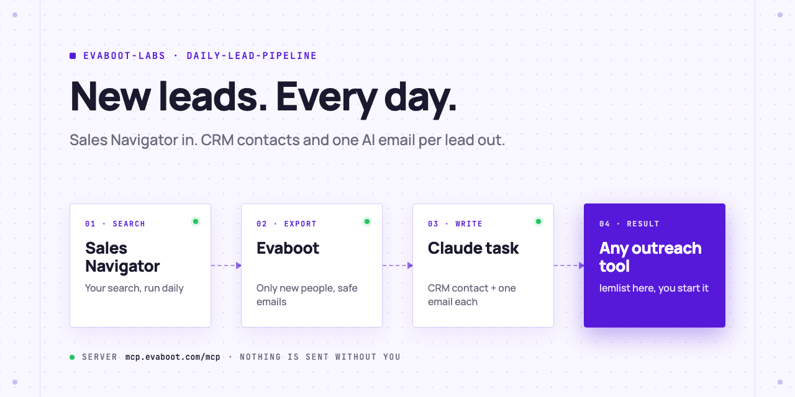
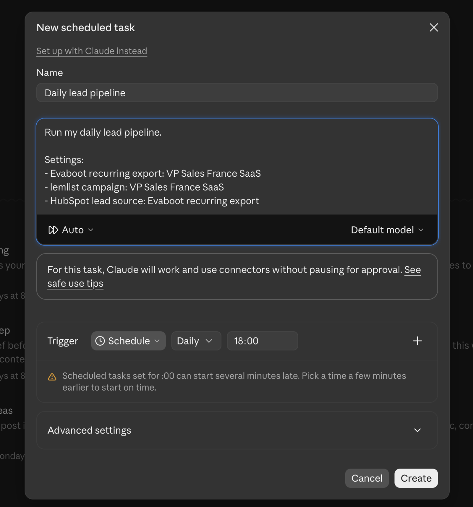
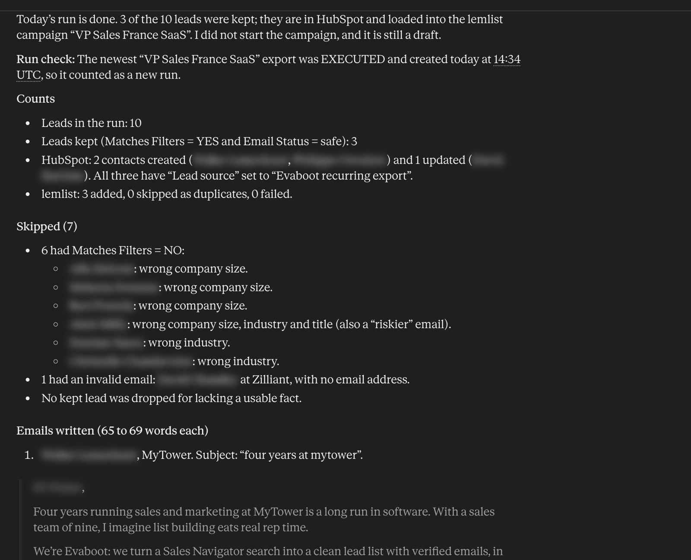
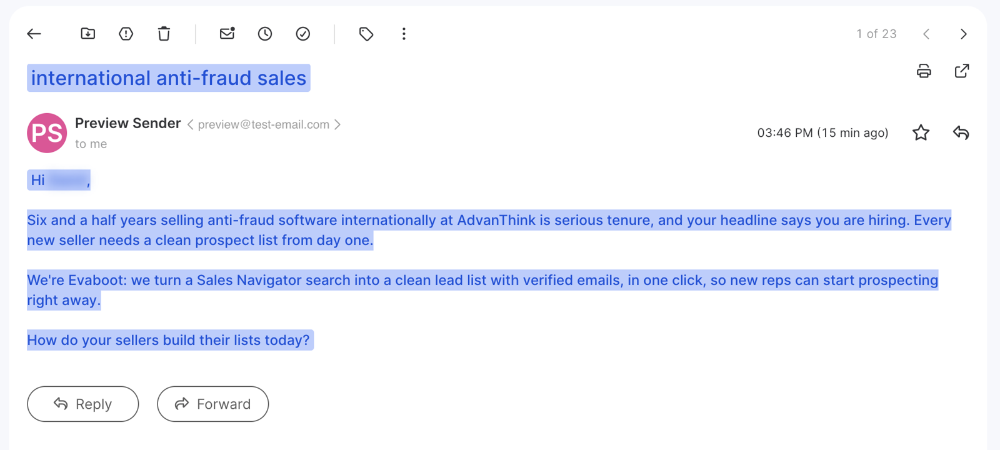

<picture>
  <source media="(prefers-color-scheme: dark)" srcset=".github/assets/banner-dark.png">
  
</picture>

# Daily lead pipeline

Every day, Evaboot brings the people new to your Sales Navigator search, with verified emails. A scheduled Claude task saves them in your CRM, writes one cold email per lead from their real data, and adds each lead with its email to your outreach campaign. You start the campaign.

[](AGENTS.md)
[](https://evaboot.com/mcp)
[](LICENSE)

## Set it up in one prompt

Paste this into Claude Code, Codex or Cursor:

```text
Clone https://github.com/evaboot-labs/daily-lead-pipeline, read AGENTS.md and follow the skill. Set up a daily pipeline for VPs of Sales in France.
```

<details>
<summary>Or install the skill</summary>

Claude Code:

```text
/plugin marketplace add evaboot-labs/daily-lead-pipeline
/plugin install daily-lead-pipeline@evaboot-labs-daily-lead-pipeline
```

Codex, Cursor and other agents:

```bash
npx skills add evaboot-labs/daily-lead-pipeline
```

</details>

## How it works

**1. One scheduled task runs it all.** Paste [TASK.md](TASK.md) with your brief into a daily Claude task. It uses three connectors: Evaboot, your CRM and your outreach tool.



**2. Only the right leads, one email each.** The task keeps leads that match your filters with a safe email, saves them in HubSpot, and writes each email from one real fact: time in role, company growth, sales team size.



**3. Your campaign fills itself.** Each lead lands in your lemlist campaign with its own subject and body. Nothing is sent until you start the campaign.



## What you need

- An [Evaboot account](https://dash.evaboot.com/accounts/signup/?last_click_origin=daily-lead-pipeline-repo) and a Sales Navigator seat.
- A CRM and any outreach tool with an MCP server. HubSpot and lemlist are the examples here.
- A paid Claude plan for scheduled tasks, or Claude Code routines.
- Cost: 1 Evaboot credit per new lead. Runs with no new leads cost nothing.

## Go further

| Page | For |
|---|---|
| [TASK.md](TASK.md) | The daily task you schedule |
| [BRIEF.md](BRIEF.md) | The brief every email follows |
| [docs/connect-your-agent.md](docs/connect-your-agent.md) | The connectors, by hand, for each agent |
| [docs/lemlist.md](docs/lemlist.md) | The campaign the leads land in |
| [docs/hubspot.md](docs/hubspot.md) | The contacts and the Lead source property |
| [docs/n8n.md](docs/n8n.md) | The same pipeline in n8n |

---

Agents: start at [AGENTS.md](AGENTS.md) · Built by [Evaboot](https://evaboot.com) · More workflows at [github.com/evaboot-labs](https://github.com/evaboot-labs) · [MIT license](LICENSE)
